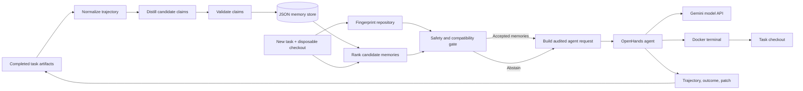

# EvoMem — Project Presentation Guide

> A concise technical briefing for presenting EvoMem: what it is designed to do, how its components interact, what has been implemented, and what the current evidence does and does not establish.

## 1. One-minute overview

EvoMem is a research prototype that adds a persistent, evidence-bearing experience-memory layer to coding-agent runs. It captures outcomes from prior software tasks, distills selected details into structured memories, checks those memories, and only supplies them to a later agent when retrieval and compatibility checks permit it. The design goal is to reuse useful engineering experience while reducing unsafe or irrelevant transfer.

The project is implemented as a Python CLI and library around OpenHands and Gemini. Its standard task path is local-checkout based. It is not yet a hosted website or multi-user service.

## 2. Problem and design goal

A coding agent normally reasons from the current prompt and repository. A previous run may contain useful information such as a test command, a repository convention, a known failure mode, or a verified implementation approach. Replaying raw transcripts is risky: they can be noisy, stale, unsafe, or unrelated to the new task.

EvoMem therefore treats prior experience as **advisory data with provenance and lifecycle status**, rather than as instructions to trust automatically. It can supply relevant memories to an agent, or abstain and let the agent solve the task without memory.

## 3. Architecture at a glance



The CLI coordinates the stages. The memory repository stores canonical records as JSON files. A run directory stores request/context data and execution artifacts. Docker is used as a terminal boundary; the model API calls happen in the host process.

## 4. The memory lifecycle

### A. Capture and normalize

A task run can produce a request, conversation trajectory, outcome, patch, and test evidence. The ingestion layer normalizes trajectory events into a consistent shape with event IDs and ordering so claims can point back to evidence.

### B. Distill

The distillation step creates a structured memory containing task description, solution guidance, claims, provenance, repository context, and evidence references. Distillation can use a deterministic local implementation or an optional provider-assisted implementation. Provider-generated interpretations remain claims to be checked; the model does not assign trusted status.

### C. Validate and store

The validator assigns each claim a result and then assigns the memory a lifecycle status such as `validated`, `partially_validated`, `rejected`, or `quarantined`. The `pipeline` command saves the record as `<memory_id>.json` in the selected store. By default, the Desktop project uses `data/memories` relative to the project working directory.

A `validated` status means the record passed the validator's configured checks. It does not necessarily mean EvoMem executed every command or independently reran every test: the current validator records execution validation as skipped. Independent test results and official grading should be retained as separate evidence.

### D. Retrieve and gate

For a new task, EvoMem reads records from the selected JSON store and ranks them by token overlap, language compatibility, and lifecycle quality. The current score is:

```text
score = 0.45 × token Dice overlap
      + 0.35 × token Jaccard overlap
      + 0.10 × language compatibility
      + 0.10 × lifecycle quality
```

The gate then checks safety patterns, lifecycle status, repository compatibility, language compatibility, and a minimum score (default `0.35`). By default, only `validated` records are eligible. An incompatible, suspicious, low-scoring, or non-validated record is rejected or abstained from; an empty memory context is an expected safe result.

The retrieval signal named `semantic_baseline` is token Dice overlap. The `index` command can build a separate local index artifact, including hash-based vectors or a configured embedding provider, but the current retrieval path does not query that index. There is no active vector database or vector-search retrieval path.

## 5. Task execution boundary

`issue-run` prepares a regular issue request from a task prompt and local repository checkout. It fingerprints the repository, retrieves and gates memories, and writes an auditable request and agent context. Without `--execute`, it is preparation-only. With `--execute`, it starts the OpenHands flow.

The model API runs outside Docker. Agent terminal commands are routed into a Docker container started from a supplied task image. The container mounts the disposable repository at `/workspace`, runs without network access, uses a read-only container root with a writable repository mount and temporary filesystem, and has resource limits (2 CPUs, 2 GB memory, and a process limit). The task checkout should be disposable; the agent should not be given a developer's primary working tree.

After execution, EvoMem records the trajectory and outcome and captures a patch diff. Run artifacts are not automatically promoted into the trusted global memory store. Review and memory admission are separate operations.

## 6. SWE-bench Lite integration

The benchmark adapter provides four main steps:

1. `swebench-plan` loads public SWE-bench Lite task metadata and freezes a seeded task order and five-condition manifest.
2. `swebench-run` validates the planned task, repository base commit, and clean checkout; it prepares or executes one task/condition.
3. `swebench-predictions` exports captured patches to the official prediction JSONL format.
4. `swebench-grade` invokes the official SWE-bench Docker harness and produces a grading report.

The conditions are `no_memory`, `candidate_memory`, `validated_semantic`, `validated_hybrid`, and `validated_hybrid_gated`. Manifest eligibility restricts which prior same-repository tasks can contribute memories so the experiment can avoid future-task leakage. A complete matrix would require all planned task/condition combinations and official grading; one resolved task is not a benchmark-wide score.

## 7. Evidence available in this checkout

The project has a one-instance official SWE-bench grading report for `astropy__astropy-6938` showing **1 completed and 1 resolved**. A focused regression test for FITS ASCII D-exponent output passed, and an evidence-backed memory for that task is stored at:

```text
data/memories/mem-3381d70a7b4320e4.json
```

Be precise when presenting this result: the initial Gemini attempts encountered quota/iteration-limit issues. The focused fix and regression test were then applied in the disposable task checkout and the official grader resolved the patch. This is evidence that the task environment, patch-export, grading, memory, and retrieval flow can be exercised; it is **not evidence that the agent autonomously solved the issue**, and it is not a full SWE-bench Lite score. The ten-task gated run did not complete a full official grading cycle.

## 8. Useful demo commands

Run these in PowerShell from the Desktop project:

```powershell
cd C:\Users\yashy\OneDrive\Desktop\EvoMem

# Show that the curated memory store is readable
.\.venv\Scripts\evomem.exe health --store .\data\memories

# Rank memories for a query
.\.venv\Scripts\evomem.exe retrieve `
  --query "Astropy FITS ASCII D exponent output_field replace" `
  --store .\data\memories `
  --language Python
```

For a task run, use `issue-run` with a clean disposable checkout, a problem description, the intended memory store, and an output directory. Add `--image`, `--model`, and `--execute` to run the agent. Inspect `agent-context.json` to show what the gate accepted or why it abstained. To create a memory from a reviewed run, process its `trajectory.json` separately with `pipeline`, then inspect the resulting memory's status.

For benchmark work, use the frozen manifest with `swebench-run`; do not substitute a normal issue run when reporting a benchmark condition. Export and grade patches with the corresponding SWE-bench commands.

## 9. Current scope and limitations

- **CLI/library, not web service:** no browser UI, HTTP API, user accounts, or job queue is implemented.
- **Local JSON persistence:** suitable for a prototype; multi-user storage, access control, encryption, backups, retention, and concurrency management need design work.
- **Baseline retrieval:** deterministic token-based hybrid ranking; no active vector-query path.
- **Validation scope:** claim checks are conservative but do not automatically execute every claim's commands or tests.
- **Task environment:** users must supply a suitable Docker image with the task dependencies. The project does not automatically construct an image for arbitrary repositories.
- **Production safety:** arbitrary repositories and images require a separately isolated worker/VM, per-run resource limits, secret isolation, authentication, quotas, monitoring, and cleanup policies.
- **Evaluation evidence:** a single resolved SWE-bench task is a smoke/functional result, not a statistically meaningful benchmark claim.

## 10. Suggested presentation summary

> “EvoMem separates the lifecycle of coding experience from the use of that experience. It captures task traces, turns evidence-backed parts into structured JSON memories, and validates their claims. On a later task, it ranks memories, checks repository and language compatibility, and passes only accepted memories to the coding agent. The agent's terminal is isolated in Docker, while requests, decisions, trajectories, outcomes, and patches are retained for audit. The current implementation is a CLI research prototype with a deterministic retrieval baseline; it does not yet have a web service or active vector-search path. We have an official one-instance Astropy resolution demonstrating the grading integration, but not a full SWE-bench Lite score.”

## 11. Source map

| Concern | Implementation |
|---|---|
| CLI commands | `src/evomem/cli.py` |
| Memory schema and JSON persistence | `src/evomem/schemas.py`, `src/evomem/repository.py` |
| Ingestion and distillation | `src/evomem/ingestion.py`, `src/evomem/distillation.py` |
| Validation and security checks | `src/evomem/validation.py`, `src/evomem/security.py` |
| Ranking, compatibility, and gating | `src/evomem/retrieval.py`, `src/evomem/versioning.py`, `src/evomem/gating.py` |
| Issue preparation and agent execution | `src/evomem/openhands_runner.py`, `src/evomem/openhands_adapter.py` |
| Docker execution boundary | `src/evomem/execution.py`, `src/evomem/sandbox_runner.py` |
| SWE-bench Lite adapter | `src/evomem/swebench_lite.py` |
| Architecture and operations docs | `docs/architecture.md`, `docs/retrieval_and_gating.md`, `docs/operations.md`, `docs/evaluation.md` |